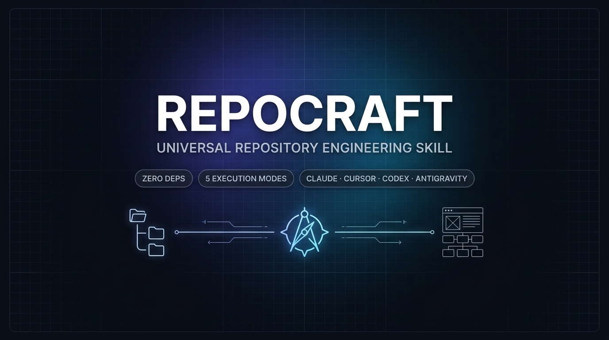
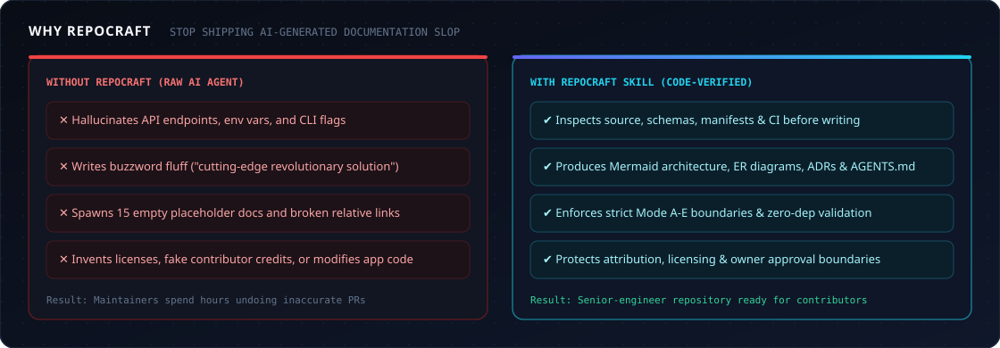
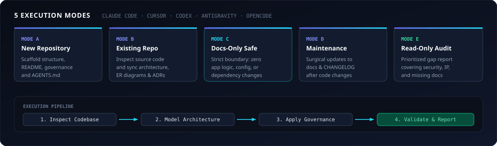

<div align="center">



<h1>RepoCraft</h1>

<p><strong>Turn any AI coding agent into a disciplined repository maintainer.</strong><br/>
A zero-dependency Agent Skill for code-verified documentation, Mermaid architecture diagrams, ADRs, governance, and attribution across Claude Code, Cursor, OpenAI Codex, Google Antigravity, and OpenCode.</p>

<p>
  <a href="https://github.com/divyprj/repocraft/actions/workflows/validate.yml"></a>
  <a href="https://agentskills.io"></a>
  
  
  <a href="LICENSE"></a>
</p>

<p>
  <a href="#why-repocraft">Why</a> •
  <a href="#30-second-install">Install</a> •
  <a href="#the-5-execution-modes">Modes</a> •
  <a href="#supported-ai-agents">Agents</a> •
  <a href="#templates-and-reference-examples">Templates</a> •
  <a href="#validation-and-ci">Validation</a>
</p>

</div>

---

<p align="center">
  
</p>

## Why RepoCraft

Left unguided, AI coding agents hallucinate endpoints, invent environment variables, dump buzzword boilerplate into `README.md`, create empty placeholder files, and overwrite attribution or license notices.

**RepoCraft** enforces senior-maintainer engineering discipline through a single canonical [`SKILL.md`](SKILL.md) built on the open [Agent Skills](https://agentskills.io) specification:

- **Code-first inspection**: Forces the agent to read source code, manifests, database schemas, and CI configs before writing a single line of documentation.
- **Real architecture artifacts**: Produces readable Mermaid context/component/ER diagrams, system design specs, API references, and Architecture Decision Records (ADRs) tied directly to actual code.
- **Practical GitHub governance**: Scaffolds maintainable `AGENTS.md`, `CODEOWNERS`, PR/issue templates, `SECURITY.md`, and `CHANGELOG.md` without bloating small repos.
- **Attribution and IP clarity**: Preserves verifiable authorship (`AUTHORS.md`, `COPYRIGHT`, `NOTICE`) and blocks agents from silently inventing or changing licenses without owner approval.
- **Zero runtime dependencies**: Pure Markdown templates, POSIX bash/PowerShell installers, and a standalone Python 3.8+ validator (`scripts/validate.py`).

---

## The 5 Execution Modes

<p align="center">
  
</p>

### Copy-Paste Invocations

| Agent | Example Prompt |
| :--- | :--- |
| **Claude Code** | `/repocraft Mode E: Audit this codebase and report missing architecture docs, security gaps, and broken links.` |
| **Cursor** | `Apply RepoCraft Mode B to inspect our database models and generate docs/architecture/database-design.md with Mermaid ER diagrams.` |
| **OpenAI Codex** | `Apply RepoCraft Mode A to initialize repository governance, CI validation, and AGENTS.md for this project.` |
| **Google Antigravity** | `Under RepoCraft Mode C (docs-only), inspect our API routes and write docs/architecture/api-reference.md.` |
| **OpenCode** | `Use RepoCraft Mode D to update CHANGELOG.md and affected docs for the recent schema migration.` |

For full workflows and prompt recipes, see [docs/usage.md](docs/usage.md).

---

## 30-Second Install

### Linux / macOS

```bash
git clone https://github.com/divyprj/repocraft.git
cd repocraft
./scripts/install.sh --agent all --scope global
```

Want automatic updates whenever you `git pull`? Use symlink mode:

```bash
./scripts/install.sh --agent all --scope global --symlink
```

<details>
<summary><strong>Windows PowerShell, project-scoped installs, and uninstall</strong></summary>

```powershell
# Windows PowerShell (Global)
git clone https://github.com/divyprj/repocraft.git
cd repocraft
.\scripts\install.ps1 -Agent all -Scope Global
```

```bash
# Install into the current repository only (deduplicates shared .agents/ paths)
./scripts/install.sh --agent all --scope project

# Install for a single agent
./scripts/install.sh --agent claude --scope global

# Preview without writing files
./scripts/install.sh --agent all --dry-run

# Cleanly remove installed skill directories
./scripts/install.sh --agent all --scope global --uninstall
```

</details>

For manual installation paths and troubleshooting, see [docs/installation.md](docs/installation.md) and [docs/troubleshooting.md](docs/troubleshooting.md).

---

## Supported AI Agents

| Agent Ecosystem | Global Discovery Path | Project Discovery Path | Status |
| :--- | :--- | :--- | :--- |
| **Anthropic Claude Code** | `~/.claude/skills/repocraft/` | `.claude/skills/repocraft/` | Verified |
| **Cursor** | `~/.cursor/skills/repocraft/` | `.cursor/skills/repocraft/` | Verified |
| **OpenAI Codex / ChatGPT** | `~/.agents/skills/repocraft/` | `.agents/skills/repocraft/` | Spec Aligned |
| **Google Antigravity** | `~/.gemini/config/skills/repocraft/` | `.agents/skills/repocraft/` | Verified |
| **OpenCode** | `~/.config/opencode/skills/repocraft/` | `.opencode/skills/repocraft/` | Supported |

See [docs/compatibility.md](docs/compatibility.md) for platform-specific notes.

---

## Templates and Reference Examples

RepoCraft ships with **17 reusable templates** and **3 complete reference repositories** so agents and engineers can follow concrete, real-world patterns:

<details>
<summary><strong>Explore templates and example layouts</strong></summary>

- **Documentation templates** (`templates/documentation/`): `README`, `AGENTS`, `CONTRIBUTING`, `SECURITY`, `CHANGELOG`, `AUTHORS`, `COPYRIGHT`
- **Architecture & ADR templates** (`templates/architecture/`, `templates/adr/`): `architecture.md`, `system-design.md`, `database-design.md`, `api-reference.md`, `ADR-000-template.md`
- **GitHub governance templates** (`templates/github/`): `CODEOWNERS`, `PULL_REQUEST_TEMPLATE.md`, `bug_report.yml`, `feature_request.yml`, `validate.workflow.yml`
- **Reference examples** (`examples/`):
  - [`examples/minimal-project/`](examples/minimal-project/README.md) : Lightweight CLI / utility setup
  - [`examples/full-stack-project/`](examples/full-stack-project/README.md) : Multi-tier web app with ER diagrams, ADRs, UI guidelines, and deployment docs
  - [`examples/ai-project/`](examples/ai-project/README.md) : ML pipeline, evaluation, and inference deployment architecture

</details>

---

## Validation and CI

RepoCraft ships with a standalone zero-dependency validator that verifies `SKILL.md` frontmatter, repository structure, relative Markdown and image links, prohibited phrasing rules, bash script syntax, and install/uninstall flows:

```bash
# Run full standalone validation
python3 scripts/validate.py

# Machine-readable JSON output for CI pipelines
python3 scripts/validate.py --json

# Run automated pytest suite
pytest -v
```

CI runs automatically on Ubuntu and macOS via [`.github/workflows/validate.yml`](.github/workflows/validate.yml).

---

## Repository Layout

```text
repocraft/
|-- SKILL.md                  # Canonical v1.1.0 skill instructions + Quick Mode Router
|-- README.md                 # Project landing page
|-- AGENTS.md                 # Root AI coding agent governance rules
|-- assets/                   # Hero banner and architecture/workflow SVGs
|-- docs/                     # Compatibility, installation, usage, design principles, troubleshooting
|-- templates/                # 17 production templates (docs, architecture, ADRs, GitHub)
|-- examples/                 # Minimal, full-stack, and AI/ML reference projects
|-- scripts/                  # install.sh, install.ps1, validate.py, sync-github.sh
|-- tests/                    # Automated pytest verification suite
|-- .github/workflows/        # Cross-platform CI validation workflow
```

---

## Known Limitations

- **Instruction, Not OS Sandbox**: Like all agent skills, RepoCraft guides the agent's reasoning and review loop; it does not enforce OS-level file permissions or network firewalls.
- **Model Capability Dependence**: Architecture extraction quality depends on the underlying model. Always review generated ADRs and security docs before merging.
- **Large Monorepos**: Repositories with hundreds of packages should be audited module-by-module (see Section 26 of [`SKILL.md`](SKILL.md)).

---

## Contributing and License

Contributions are welcome! Read [CONTRIBUTING.md](CONTRIBUTING.md) and [CODE_OF_CONDUCT.md](CODE_OF_CONDUCT.md) before opening a PR.

Created by **Divyansh Prajapati** ([AUTHORS.md](AUTHORS.md)). Licensed under **Apache-2.0** ([LICENSE](LICENSE) | [COPYRIGHT](COPYRIGHT) | [NOTICE](NOTICE)).

<div align="center">
  <br/>
  <strong>If RepoCraft keeps your repos clean and accurate, consider giving it a ⭐ on GitHub!</strong>
</div>
