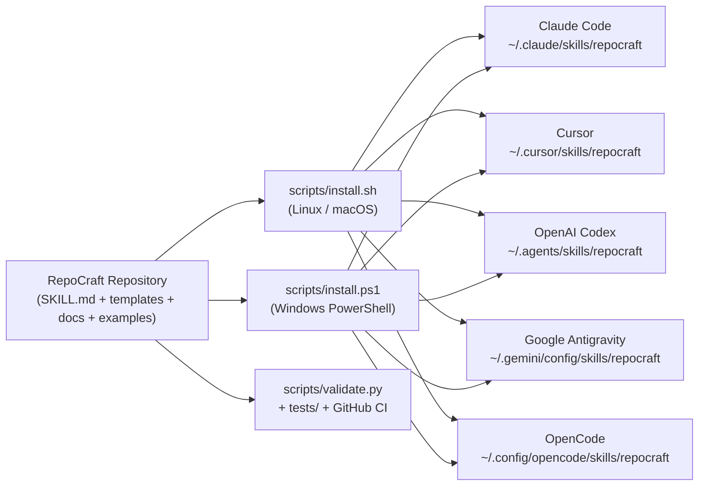

# RepoCraft Architecture

This document describes the actual architecture of the RepoCraft repository and its distribution, validation, and agent-discovery pipeline.

## System Overview

RepoCraft is a zero-runtime-dependency Agent Skills package. A single canonical `SKILL.md` file at the repository root defines all engineering standards, while lightweight POSIX/PowerShell installers deploy that package to multiple AI coding agent discovery directories without creating divergent forks.

## Major Components

| Component | Path | Responsibility |
| :--- | :--- | :--- |
| Canonical Skill | `SKILL.md` | Authoritative YAML frontmatter, Quick Mode Router, 26 engineering sections, and verification rules. |
| Templates | `templates/` | 17 reusable Markdown/YAML scaffolds for documentation, architecture, ADRs, and GitHub governance. |
| Reference Examples | `examples/` | 3 concrete reference layouts (minimal CLI, full-stack web, AI/ML pipeline). |
| Installers | `scripts/install.sh`, `scripts/install.ps1` | Copy or symlink skill assets across 5 agent ecosystems with shared-path deduplication and safe uninstall. |
| Validator & CI | `scripts/validate.py`, `tests/`, `.github/workflows/validate.yml` | Verifies frontmatter schema, required files, relative links and HTML image paths, bash syntax, and prohibited character rules. |
| Metadata Sync | `scripts/sync-github.sh` | Synchronizes GitHub repository description, topics, and releases via `gh` CLI. |

## Design Constraints

- **Zero external runtime dependencies**: Installation and validation rely solely on Bash/PowerShell and Python 3.8+ standard library modules.
- **Single source of truth**: All target agents read the exact same `SKILL.md` instructions; no per-agent forks are maintained.
- **Path deduplication**: In project scope, Codex and Antigravity share `.agents/skills/repocraft`. Both installers deduplicate resolved target paths before writing.
