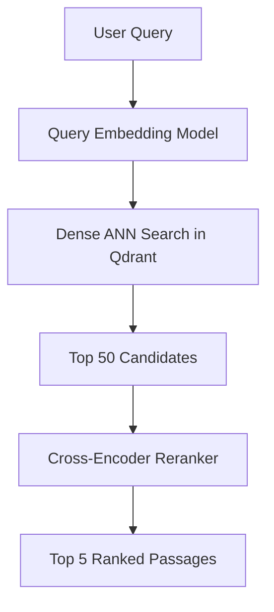

# DocRetriever (Example AI/ML Project)

> **Notice**: This is an illustrative reference project created to demonstrate RepoCraft repository engineering standards for AI and machine learning systems.

A high-performance dense retrieval and semantic reranking engine for enterprise documentation search.

## Overview

DocRetriever processes unstructured technical manuals, generates dense vector embeddings using a fine-tuned embedding model, stores vectors in Qdrant, and applies a cross-encoder reranking pass to deliver top-k relevant documentation chunks.

## Architecture Summary



For complete technical specifications, see:
- System Architecture: [docs/architecture/architecture.md](docs/architecture/architecture.md)
- Model Specifications: [docs/architecture/model-architecture.md](docs/architecture/model-architecture.md)
- Data Pipeline & Chunking: [docs/architecture/data-pipeline.md](docs/architecture/data-pipeline.md)
- Evaluation Methodology: [docs/architecture/evaluation.md](docs/architecture/evaluation.md)
- Inference Deployment: [docs/architecture/inference-deployment.md](docs/architecture/inference-deployment.md)

## Tech Stack

- **Model Frameworks**: PyTorch 2.3+, Hugging Face Transformers, Sentence-Transformers
- **Inference Runtime**: ONNX Runtime with CUDA execution provider
- **Vector Database**: Qdrant 1.9+
- **Evaluation**: Ragas, BEIR benchmark suite

## Local Setup

```bash
# 1. Clone repository
git clone https://github.com/example/doc-retriever.git
cd doc-retriever

# 2. Setup virtual environment
python3 -m venv .venv
source .venv/bin/activate
pip install -r requirements.txt

# 3. Start local Qdrant instance
docker run -d -p 6333:6333 qdrant/qdrant:v1.9.0

# 4. Run retrieval evaluation benchmark
python3 scripts/evaluate.py --dataset technical-qa-v1
```

## License and Attribution

Licensed under the Apache License, Version 2.0. Copyright 2026 DocRetriever Contributors.
See [AGENTS.md](AGENTS.md) for coding agent guidelines.
