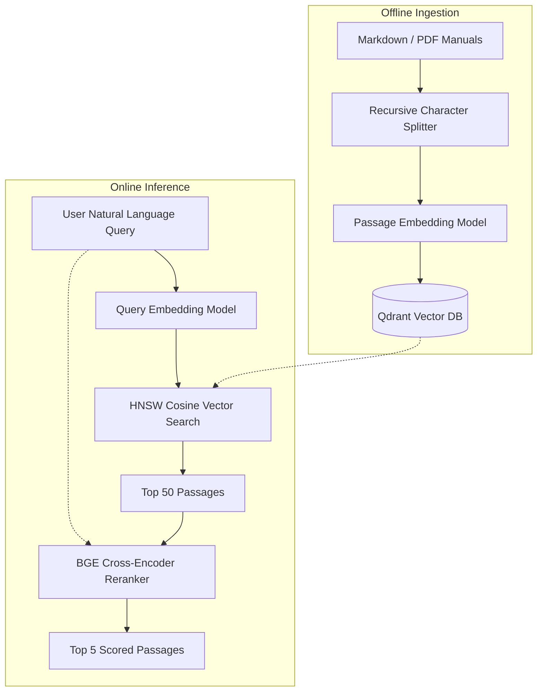

# DocRetriever Architecture Documentation

> **Notice**: Illustrative architecture document for an AI/ML retrieval system.

## 1. System Pipeline Architecture

DocRetriever operates as a two-stage retrieval-and-rerank pipeline:

## 2. Pipeline Subsystems

1. **Ingestion & Indexing Pipeline**: Handles document extraction, chunking with metadata preservation, batch embedding computation, and vector database insertion.
2. **First-Stage Dense Retriever**: High-speed Approximate Nearest Neighbor (ANN) search over 1024-dimensional embeddings using HNSW indexing.
3. **Second-Stage Reranker**: Full cross-attention model scoring query-passage pairs to reorder candidate passages based on semantic relevance.
