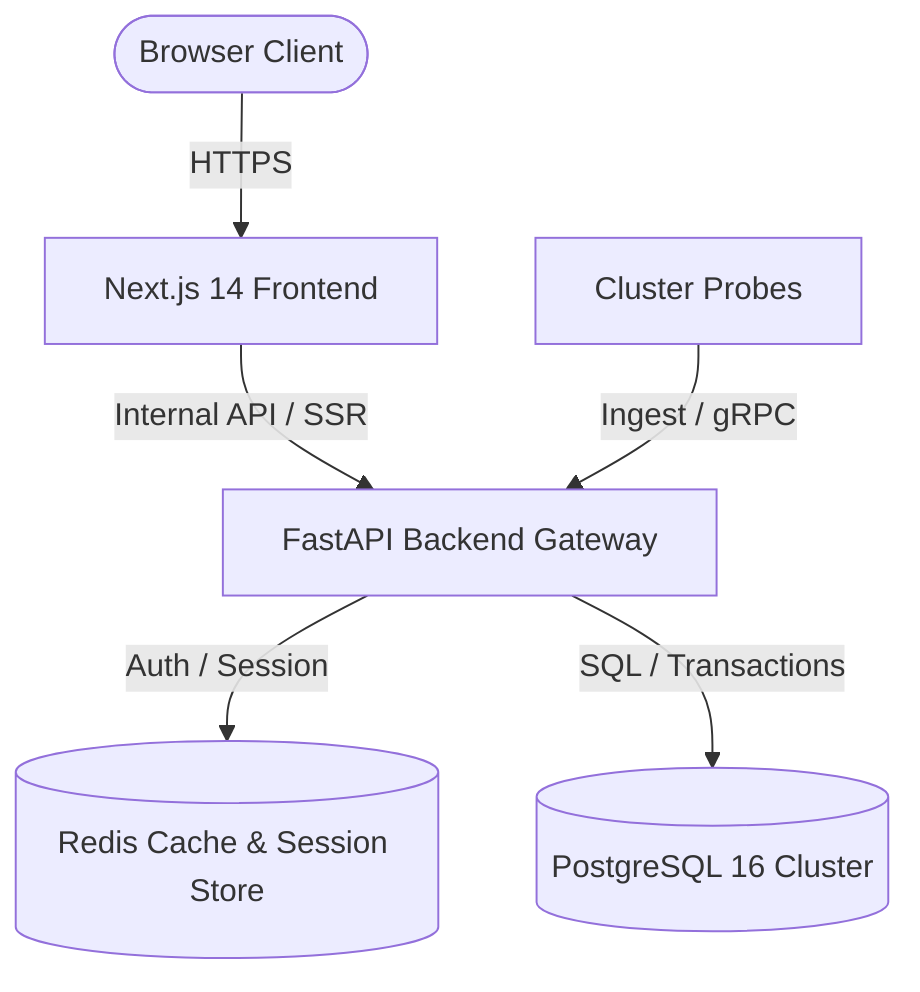

# PulseOps (Example Full-Stack Project)

> **Notice**: This is an illustrative reference project created to demonstrate RepoCraft repository engineering standards for multi-tier full-stack applications.

An enterprise infrastructure health monitoring dashboard and alert dispatcher.

## Overview

PulseOps collects synthetic heartbeats, system telemetry, and alert triggers across server clusters, aggregates metrics in PostgreSQL, and renders live status visualizations in a React/Next.js frontend.

## Architecture Summary



For complete architectural specifications, see:
- System Architecture: [docs/architecture/architecture.md](docs/architecture/architecture.md)
- Subsystem Design: [docs/architecture/system-design.md](docs/architecture/system-design.md)
- Database Design: [docs/architecture/database-design.md](docs/architecture/database-design.md)
- API Reference: [docs/architecture/api-reference.md](docs/architecture/api-reference.md)
- Architecture Decisions: [docs/architecture/decisions/ADR-001-postgresql-and-redis.md](docs/architecture/decisions/ADR-001-postgresql-and-redis.md)
- Design Guidelines: [docs/design/ui-guidelines.md](docs/design/ui-guidelines.md)
- Deployment Guide: [docs/deployment/deployment.md](docs/deployment/deployment.md)

## Tech Stack

- **Frontend**: Next.js 14 (App Router), TypeScript, Tailwind CSS
- **Backend API**: Python 3.12, FastAPI, SQLAlchemy 2.0 (asyncio)
- **Database**: PostgreSQL 16 (timescaledb extension for metrics)
- **Cache / PubSub**: Redis 7
- **Deployment**: Docker Compose, Kubernetes manifests

## Local Development Setup

```bash
# 1. Clone repository
git clone https://github.com/example/pulse-ops.git
cd pulse-ops

# 2. Start PostgreSQL and Redis via Docker Compose
docker compose up -d postgres redis

# 3. Setup backend
cd backend
python3 -m venv .venv
source .venv/bin/activate
pip install -r requirements.txt
alembic upgrade head
uvicorn app.main:app --reload --port 8000

# 4. Setup frontend (in a separate terminal)
cd ../frontend
npm install
npm run dev
```

## Running Tests

```bash
# Backend tests
pytest backend/tests/

# Frontend tests
npm --prefix frontend test
```

## License and Attribution

Licensed under the Apache License, Version 2.0. Copyright 2026 PulseOps Contributors.
See [AGENTS.md](AGENTS.md) for coding agent guidelines.
