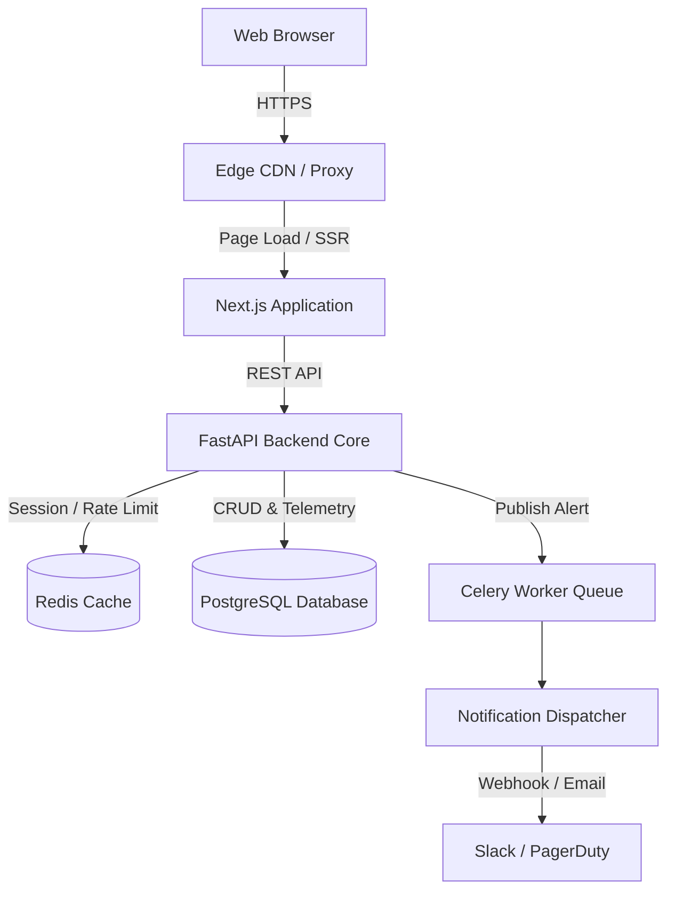

# PulseOps Architecture Documentation

> **Notice**: Illustrative architecture document demonstrating full-stack engineering standards.

## 1. Architectural Style

PulseOps employs a modular service-oriented architecture with decoupled presentation and application layers:

- **Frontend Tier**: Next.js 14 utilizing Server Components for initial data fetching and Client Components for dynamic WebSocket metrics graphs.
- **Backend Tier**: FastAPI asynchronous application handling ingestion, alert evaluation, and query APIs.
- **Persistence Tier**: PostgreSQL for transactional metadata and timescaled telemetry records, backed by Redis for rate limiting and ephemeral session caching.

## 2. Component Diagram

## 3. Communication Protocols

- **External Client to Backend**: HTTPS with TLS 1.3 using REST endpoints and JSON payloads.
- **Probe Ingestion**: gRPC over HTTP/2 for high-throughput probe status reports.
- **Real-Time UI Updates**: Server-Sent Events (SSE) streaming live telemetry alerts to the frontend.

## 4. Security Boundaries

1. **Edge Boundary**: Reverse proxy terminates TLS, enforces HTTP security headers, and applies rate limits.
2. **Application Boundary**: JWT authentication with rotating keys. Role-Based Access Control (RBAC) separates viewer, engineer, and administrator capabilities.
3. **Database Boundary**: Database credentials stored exclusively in encrypted environment secrets; direct database port access restricted to internal private network.
