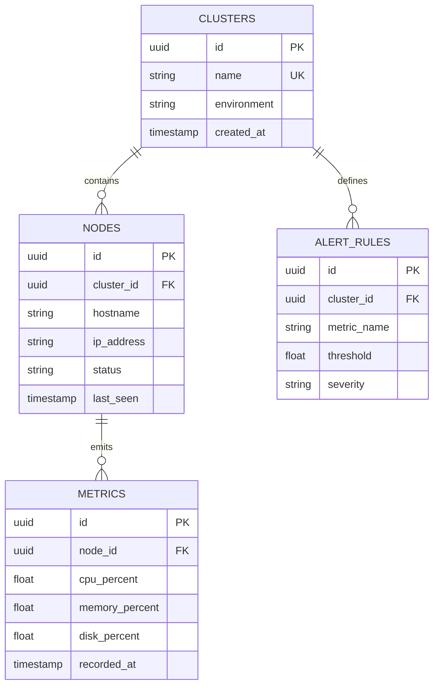

# PulseOps Database Design

> **Notice**: Illustrative database design document.

## 1. Engine and Extensions

- **Database Engine**: PostgreSQL 16
- **Extensions**: `uuid-ossp` (UUID generation), `btree_gist` (indexing constraints)
- **Migrations**: Managed via Alembic under `backend/alembic/`

## 2. Entity Relationship Diagram

## 3. Important Indexes

- `idx_nodes_cluster_id`: BTREE on `nodes(cluster_id)`
- `idx_metrics_node_recorded`: BTREE on `metrics(node_id, recorded_at DESC)`
- `idx_alert_rules_cluster`: BTREE on `alert_rules(cluster_id)`
