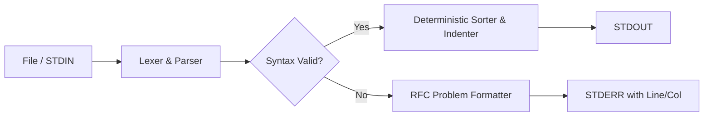

# json-tidy (Example Project)

> **Notice**: This is an illustrative reference project created to demonstrate RepoCraft repository engineering standards for small software utilities.

A fast, zero-dependency command-line utility for formatting, validating, and filtering JSON streams.

## Overview

`json-tidy` reads JSON payloads from standard input or files, verifies syntax validity, strips invalid characters, and outputs standardized, indented JSON with predictable key sorting.

## Key Features

- **Stream Validation**: Parses and validates multiline JSON streams.
- **Deterministic Key Sorting**: Sorts object keys recursively for reproducible diffing.
- **Colorized Formatting**: Terminal output with syntax highlighting.
- **Zero External Dependencies**: Implemented purely using standard library modules.

## Architecture Overview



For component details, see [docs/architecture/architecture.md](docs/architecture/architecture.md).

## Installation

```bash
git clone https://github.com/example/json-tidy.git
cd json-tidy
pip install -e .
```

## Usage

```bash
# Format a file in place
json-tidy --sort-keys data.json

# Validate from stdin
cat raw.json | json-tidy --check
```

## Running Tests

```bash
pytest
```

## License

Licensed under the MIT License. See [LICENSE](LICENSE) and [COPYRIGHT](COPYRIGHT).
Author credits are listed in [AUTHORS.md](AUTHORS.md).
