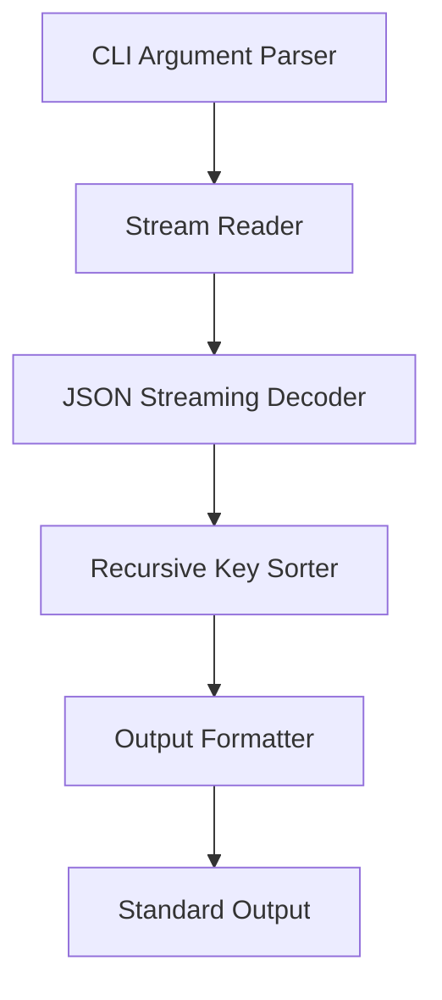

# json-tidy: Architecture Documentation

> **Notice**: Illustrative architecture document demonstrating minimal project standards.

## 1. Subsystem Architecture

`json-tidy` is structured into three discrete phases:

1. **CLI and Argument Parser**: Validates flags, handles file paths, and switches between standard input and file streaming.
2. **Parser and Validator**: Reads chunks from the input stream and builds an abstract syntax tree using the standard library JSON decoder.
3. **Deterministic Formatter**: Recursively sorts key-value mappings alphabetically and emits formatted JSON text with configurable indent spacing (default: 2 spaces).

## 2. Component Diagram

## 3. Error Handling

When syntax errors are detected, line and column offsets are formatted according to the GNU standard error format:

`input.json:14:2: error: expecting property name enclosed in double quotes`
