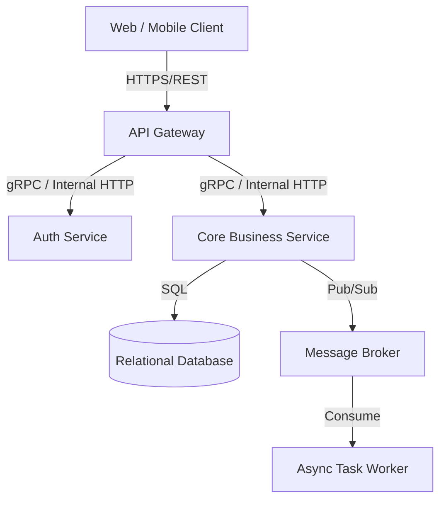
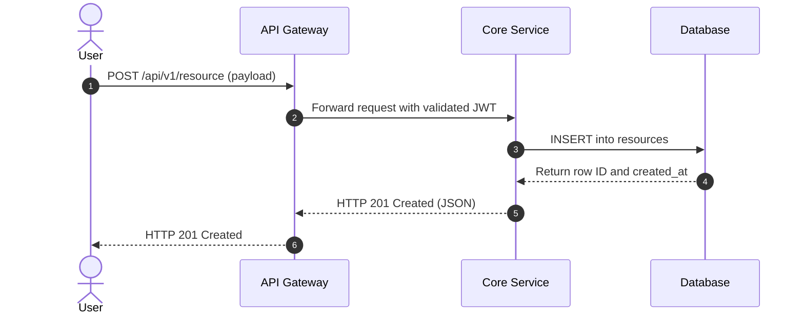

# System Architecture

## 1. Overview and Style

Describe the overarching architectural pattern (e.g. Clean Architecture, Hexagonal, Modular Monolith, Microservices) and the design goals.

## 2. Component Diagram

## 3. Core Components

### API Gateway / Router
- **Role**: Request routing, rate limiting, SSL termination, and CORS enforcement.
- **Protocols**: HTTPS, WebSocket.

### Core Service
- **Role**: Domain business logic, transaction boundaries, and entity management.
- **Dependencies**: Relational database, cache layer.

### Background Worker
- **Role**: Asynchronous execution of long-running tasks, email dispatch, and reports.

## 4. Data Flow

## 5. Security and Network Boundaries

- Describe authentication boundaries (JWT validation, session tokens).
- Describe internal service networks vs public-facing interfaces.
- Specify transport encryption (TLS 1.3) and storage encryption at rest.

## 6. Known Constraints and Trade-offs

- Document known scale limits, latency characteristics, or single points of failure.
