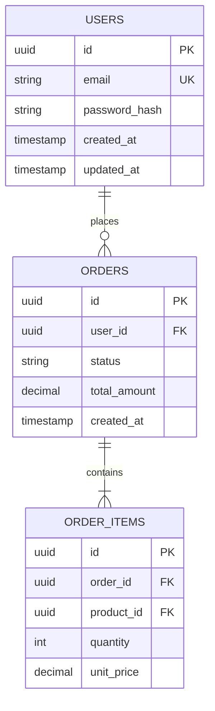

# Database Design

## 1. Engine and Storage Architecture

- **Technology**: PostgreSQL 16+ / MySQL 8+ / SQLite 3
- **Migration Engine**: Alembic / Prisma / Flyway / Goose
- **Connection Pooling**: PgBouncer / Internal driver pool

## 2. Entity Relationship Diagram

## 3. Tables and Indexes

### Table: `users`
- `id` (UUID, Primary Key)
- `email` (VARCHAR(255), Unique, Not Null)
- `created_at` (TIMESTAMPTZ, Default NOW())
- **Indexes**: `idx_users_email` (BTREE on `email`)

### Table: `orders`
- `id` (UUID, Primary Key)
- `user_id` (UUID, Foreign Key referencing `users(id)`)
- `status` (VARCHAR(32), Not Null)
- **Indexes**: `idx_orders_user_id` (BTREE on `user_id`), `idx_orders_status` (BTREE on `status`)

## 4. Data Retention and Privacy

- Document retention periods, soft-delete policies (`deleted_at`), and archival jobs.
