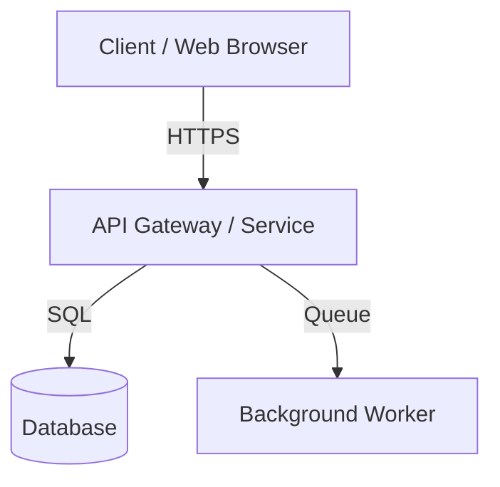

# Project Name

A concise, factual description of what this project does and the primary problem it solves.

## Overview

Provide a 1 to 2 paragraph technical overview of the software, its primary use case, and its architecture context. Avoid marketing language or speculative claims.

## Key Features

- **Feature One**: Brief description of real capability with technical details.
- **Feature Two**: Brief description of real capability with technical details.
- **Feature Three**: Brief description of real capability with technical details.

## Technology Stack

- **Runtime / Language**: Python 3.11+ / Node.js 20+ / Go 1.22+
- **Framework**: FastAPI / Next.js / Gin
- **Database**: PostgreSQL 16+ / SQLite
- **Infrastructure**: Docker / Kubernetes

## Architecture Overview



For detailed architecture diagrams and component interactions, see [docs/architecture/architecture.md](docs/architecture/architecture.md).

## Prerequisites

- Required tool or runtime version
- Package manager (e.g. pnpm, uv, cargo)
- External dependencies (e.g. Docker, PostgreSQL)

## Installation

```bash
# Clone the repository
git clone https://github.com/organization/project-name.git
cd project-name

# Install dependencies
npm install # or poetry install, cargo build
```

## Environment Configuration

Copy the example environment file and configure required parameters:

```bash
cp .env.example .env
```

| Variable | Description | Required | Default |
| :--- | :--- | :--- | :--- |
| `PORT` | Local service port | No | `8000` |
| `DATABASE_URL` | PostgreSQL connection string | Yes | None |

## Running Locally

```bash
# Start the local development server
npm run dev # or uvicorn app.main:app --reload
```

## Running Tests

```bash
# Run unit and integration tests
npm test # or pytest
```

## Project Structure

```text
project-name/
|-- src/             # Application source code
|-- tests/           # Unit and integration test suite
|-- docs/            # Architecture and system documentation
|-- .github/         # CI/CD workflows and repository governance
|-- README.md        # Primary entry point
```

## Contributing

See [CONTRIBUTING.md](CONTRIBUTING.md) for contribution guidelines, coding standards, and branch policies.

## License and Attribution

Licensed under the Apache License, Version 2.0 (or your chosen license). See [LICENSE](LICENSE) for details.
Copyright and authorship details are documented in [COPYRIGHT](COPYRIGHT) and [AUTHORS.md](AUTHORS.md).
